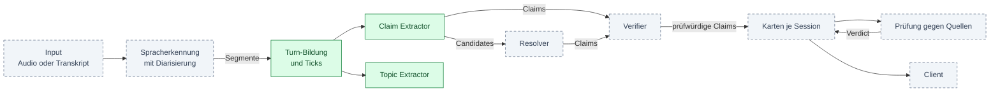
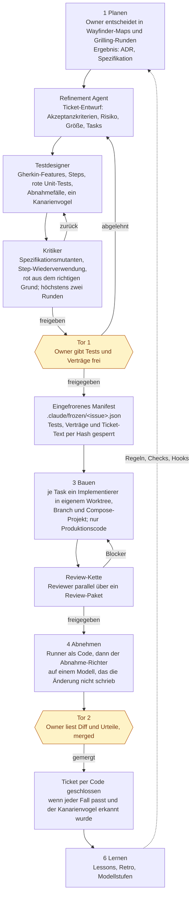
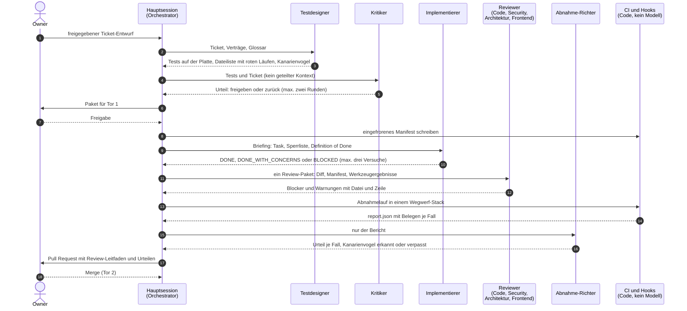
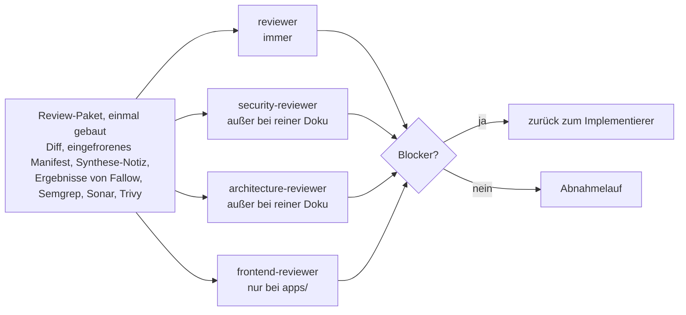
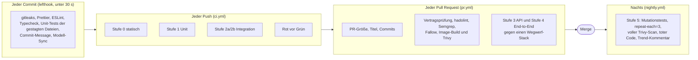
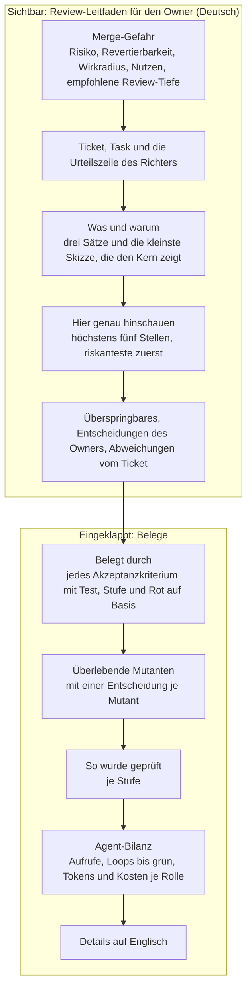
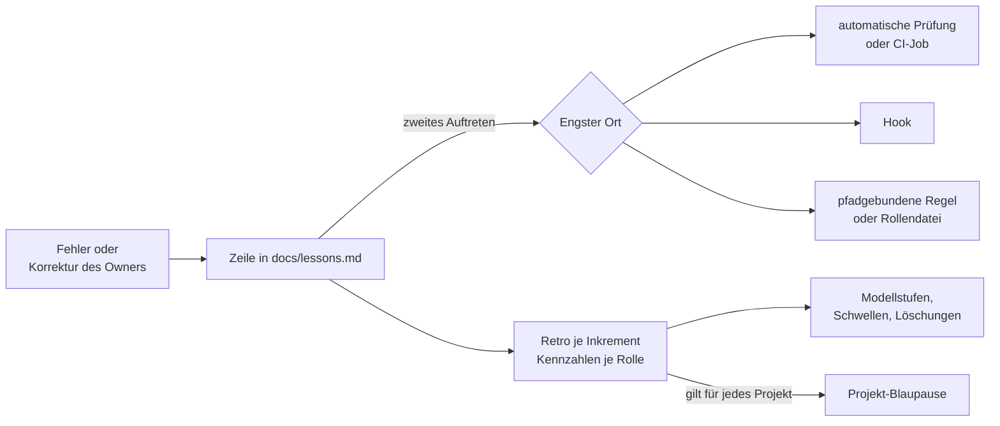

# live-factchecker-v2

[English](README.md) · **Deutsch**

> **Referenzkopie.** Dieses Repository ist eine bereinigte Kopie eines privaten Projekts (Stand 2026-11-20) mit frischer Historie. Das private Projekt testet und misst gegen ein Golden Set aus Ausschnitten von Sendungsmitschnitten, das nicht veröffentlicht werden kann. Hier stehen zwei synthetische Ausschnitte an seiner Stelle (`evals/golden/README.md`): gleiche Struktur und Zeiten, erzeugte Pseudowörter statt Sprache, erzeugte Namen statt realer Personen. Damit läuft die Testsuite wie im privaten Projekt; lokal geprüft am 2026-11-20: 1.543 Unit-Tests in sechs Workspaces, 45 Integrationsszenarien (Stufe 2a), 11 API-Szenarien gegen den gebauten Stack (Stufe 3), Typecheck, Lint und Formatprüfung, 223 Tests der Prüfskripte. Nicht enthalten: der Mess-Harness unter `evals/`, die Messberichte, die Recherche-Notizen unter `docs/research/` (Verweise aus ADRs darauf führen ins Leere), Issues und die bisherige Historie. GitHub Actions sind in diesem Repository abgeschaltet.

Ein Produkt, das einem Gespräch zuhört, die Tatsachenbehauptungen darin herauszieht, jede gegen Quellen prüft und das
Ergebnis auf einer Karte zeigt, während das Gespräch noch läuft. Dieses Repository enthält das Produkt **und** das
Agenten-Arbeitssystem, das es baut: elf KI-Agentenrollen mit festen Zuständigkeiten, zwei Tore des Owners und
Qualitätsprüfungen, die als Code laufen.

Der Owner (Marco) führt die Architektur und entscheidet an den Toren; Agenten schreiben Tests, Code und Reviews in
getrennten Rollen. Die Regel, auf der das ganze System ruht: **Wer den Code schreibt, schreibt nie die Tests dazu, und
niemand repariert einen Test, um grün zu werden.**

| | |
|---|---|
| Stand | Inkrement 1 in Arbeit: Erkennungspipeline im Backend, noch kein Client |
| Stack | TypeScript (strict, ESM), pnpm Workspaces, Node LTS, Redis, Caddy, Docker Compose, GitHub Actions |
| Tests | Vitest und fast-check (Unit), Cucumber (Integration, API, End-to-End), Playwright, StrykerJS (Mutation) |
| Agenten | Claude Code mit 11 Rollen, 12 Hooks, 12 Skills und 3 deterministischen Workflows unter `.claude/` |

## Inhalt

1. [Was das Produkt tut](#1-was-das-produkt-tut)
2. [Wie aus einem Ticket gemergter Code wird](#2-wie-aus-einem-ticket-gemergter-code-wird)
3. [Wie die Agenten zusammenarbeiten](#3-wie-die-agenten-zusammenarbeiten)
4. [Qualitätstore und Teststufen](#4-qualitätstore-und-teststufen)
5. [Der Pull Request](#5-der-pull-request)
6. [Lernschleife](#6-lernschleife)
7. [Repository-Karte](#7-repository-karte)
8. [Befehle](#8-befehle)

## 1. Was das Produkt tut

Audio oder ein Transkript kommt über einen Input herein. Die Spracherkennung schneidet es in Segmente (je ein
Speaker). Der Erkennungsdienst baut aus den Segmenten Turns und analysiert sie bei jedem Tick, alle fünf Sekunden
Redezeit. Modellrollen extrahieren, klären und prüfen dann Claims; jeder Claim wird zu einer Karte, die später ihr
Urteil (Verdict) bekommt.

Grün: in Inkrement 1 bisher gebaut, läuft gegen einen Mock-Modelladapter (`services/detection`, mit
`packages/contracts`, `packages/inputs`, `packages/providers`, `packages/service-kit`). Gestrichelt: in den ADRs
entschieden, noch nicht gebaut. Das vollständige Bild mit jeder Entscheidung und ihrer Quelle steht in
`docs/architecture.md`; die Begriffe sind in `CONTEXT.md` definiert.

## 2. Wie aus einem Ticket gemergter Code wird

Jede Änderung geht denselben Weg. Der Owner entscheidet zweimal: an **Tor 1** darüber, was „fertig“ bedeutet (Tests
und Verträge, bevor Code existiert), und an **Tor 2** über den fertigen Pull Request.

Was den Weg trägt:

- **Erst Tests, dann eingefroren.** Nach Tor 1 verweigert ein Hook allen Rollen außer dem Testdesigner jede Änderung
  an den eingefrorenen Dateien; ein Stop-Hook vergleicht jede eingefrorene Datei mit ihrem Hash, bevor ein Agent
  fertig melden darf.
- **Rot vor Grün.** CI checkt die Basis des PR aus, legt nur die eingefrorenen Tests darauf und erwartet, dass sie aus
  dem richtigen Grund scheitern (fehlendes Verhalten, kein Syntaxfehler und kein fehlendes Paket). Grün auf der Basis
  blockiert den PR.
- **Ein Task je PR**, unter etwa 400 Produktionszeilen, als Draft eröffnet, per Squash gemergt.
- **Niedriges Risiko merged ohne den Owner.** Einen PR mit Risiko niedrig (revertibel und örtlich), der Review,
  Abnahme und CI bestanden hat und keinen geschützten Pfad berührt, merged die Hauptsession selbst und listet ihn dem
  Owner danach auf (`docs/process/pr-format.md`, „Auto-merge at low risk“).

Details: `docs/process/rollen.md` (Rollen und Tore), `docs/process/tickets.md` (Ticket-Ebenen und Vorlage),
`docs/process/wayfinder.md` (Planungs-Maps und die tägliche Owner-Stunde).

## 3. Wie die Agenten zusammenarbeiten

Die orchestrierende Hauptsession startet jeden Agenten mit einem schriftlichen Briefing; kein Agent ruft einen anderen
in freier Folge auf. Die drei wiederkehrenden Ketten (Testdesign, Review, Abnahme) sind deterministische Skripte unter
`.claude/workflows/`.

### Rollen und Modellstufen

Stärkere Modelle prüfen schwächere, und der Richter läuft nie auf dem Modell, das die Änderung geschrieben hat. Die
Stufen stehen in `.claude/models.json`; `tools/sync_agent_models.py --check` lässt den Build scheitern, wenn eine
Untergrenze verletzt ist.

| Rolle | Tut | Tut nie | Stufe |
|---|---|---|---|
| refinement | entwirft das Ticket aus ADR und Spezifikation | Code oder Tests schreiben | stark |
| test-designer | schreibt Features, Steps, rote Unit-Tests, Abnahmefälle, Kanarienvogel | Produktionscode schreiben | stark |
| critic | greift die Tests mit Spezifikationsmutanten an; Veto vor Tor 1 | Tests ändern | spitze |
| implementer | macht die eingefrorenen roten Tests grün | eingefrorene Tests anfassen, pushen, PRs öffnen | stark, Effort nach Ticket-Risiko |
| reviewer | findet Agenten-Abkürzungen: aufgeweichte Typen und Tests, Gold Plating | Code ändern | stark |
| security-reviewer | Secrets, Eingabegrenzen, Datenschutzgrenze, CI-Sicherheit; jeder Befund blockiert | Code ändern | stark |
| architecture-reviewer | Modulgrenzen, doppelter Zustand, fehlende ADRs | Code ändern | spitze |
| frontend-reviewer | Komponenten, Barrierefreiheit, i18n; nur bei Änderungen unter `apps/` | Code ändern | stark |
| acceptance-judge | beurteilt die geschriebene Erwartung gegen die Belege | Code lesen, Tests ausführen | spitze |
| platform-engineer | Dockerfiles, Compose, CI, Make-Ziele nach den zwölf Faktoren | den Stack des Owners anfassen | stark |
| platform-coach | begleitet Tasks, die der Owner von Hand baut | für den Owner bauen | stark |

Stufen heute: spitze = Claude Fable 5.1, stark = Claude Opus 5.5, mittel = Claude Sonnet 5.5, guenstig = Claude Haiku 5.5.

### Die Review-Kette

Alle Reviewer bekommen dasselbe Paket als Prompt-Präfix und starten parallel. Sie berichten mit Datei und Zeile und
ändern nie etwas.

### Isolation

Jeder Agenten-Stack läuft als eigenes Compose-Projekt `lfc-<issue>-<task>` mit eigenen Ports und Wegwerf-Secrets;
Implementierer arbeiten in einem eigenen Git-Worktree. Hooks verweigern den Zugriff auf Secrets, auf den Stack des
Owners und auf eingefrorene Dateien. Die Hooks sind nur Frühwarnung; die eigentlichen Wächter sind die
Pre-Commit-Prüfungen (lefthook) und CI.

## 4. Qualitätstore und Teststufen

Jedes Verhalten wird auf der niedrigsten Stufe getestet, die es zeigen kann; Duplikate über Stufen hinweg gibt es
nicht. Die Zielverteilung je Ticket liegt bei etwa 80 % Stufe 1, 15 % Stufen 2a bis 3 und höchstens 5 % Stufe 4.

| Stufe | Frage | Werkzeug |
|---|---|---|
| 0 statisch | baut es und hält es die mechanischen Regeln ein | tsc strict, ESLint, Prettier, dependency-cruiser, gitleaks |
| 1 Unit | rechnet das Modul richtig | Vitest neben dem Modul, fast-check für reine Logik |
| 2a Backend-Integration | arbeiten die Module eines Dienstes zusammen | Cucumber im Prozess, Container nur für Infrastruktur |
| 2b Frontend-Integration | verhält sich der Client gegen ein gemocktes Backend richtig | Cucumber und Playwright (ab Inkrement 2) |
| 3 API | läuft der Pfad durch den echten Stack | Cucumber über HTTP und WebSocket gegen den Compose-Stack |
| 4 End-to-End | sieht der Nutzer das Richtige | Cucumber und Playwright durch die Edge (ab Inkrement 2) |
| 5 nachts | was Minuten oder Geld kostet | StrykerJS, wiederholte Läufe als Flake-Finder, voller Image-Scan |

Weitere Regeln: Ein Test, der scheitert und in seiner einzigen Wiederholung besteht, gilt als flaky und bekommt
automatisch ein Issue; einen Test zu überspringen oder in Quarantäne zu setzen, entscheidet nur der Owner. Die beiden
Pflicht-Checks heißen `ci passed` und `pr passed`; `make ci-local` führt dieselben Prüfungen vor einem Push aus.
Details: `docs/process/test-strategy.md`, `docs/process/review-tools.md`.

### Abnahme aus Sicht des Owners

Abnahmefälle werden vor dem Code geschrieben und mit den Tests eingefroren. Einer davon ist ein **Kanarienvogel**: ein
Fall, der plausibel formuliert, gegen das Ticket aber eindeutig falsch ist. Ein Richter, der den Kanarienvogel
durchlässt, wird verworfen und der Lauf einmal wiederholt; scheitert er erneut, liest der Owner den Bericht ohne
Urteil.

## 5. Der Pull Request

Ein PR ist für einen Leser geschrieben, der das Ticket nicht gesehen hat. Zuerst kommt der deutsche Review-Leitfaden,
die technischen Details stehen eingeklappt darunter (`.github/pull_request_template.md`, Regeln in
`docs/process/pr-format.md`).

- **Das Risiko wird hergeleitet, nicht gefühlt.** Nicht revertibel heißt: Verträge oder Schema, Daten, Secrets, CI
  oder nach außen sichtbares Verhalten. Risiko niedrig = revertibel und örtlich; hoch = nicht revertibel oder
  systemweit; sonst mittel.
- **Verweise werden zitiert, nie nackt genannt.** Neben jedem Akzeptanzkriterium, jeder Entscheidung und jeder
  ADR-Nummer steht der Satz, auf den sie verweist, damit sich der PR lesen lässt, ohne das Ticket zu öffnen.
- **Die Urteile des Richters sind ein PR-Kommentar** je Abnahmelauf, mit einem Zitat und höchstens zwei Bildern je
  Fall.
- **Commits stehen in Review-Reihenfolge**: Vertrag, rote Tests, Logik, Verdrahtung, Doku.

## 6. Lernschleife

Kein Fehler soll zweimal passieren. Das erste Auftreten eines Agentenfehlers oder einer Korrektur des Owners wird
eine Zeile in `docs/lessons.md`; beim zweiten Auftreten wird daraus eine Regel, bevorzugt als automatische Prüfung
statt als Prosa.

Die Retro liest die Zahlen, die die PRs sammeln (Loops bis grün, Tokens je Rolle, Anteil berechtigter
Reviewer-Befunde, Richter-Quote), und kann Modellstufen ändern. Was für jedes Projekt gelten würde, fließt in ein
eigenes Blaupausen-Repository zurück, von dem neue Projekte starten.

## 7. Repository-Karte

| Pfad | Inhalt |
|---|---|
| `services/detection/` | der Erkennungsdienst: Segmente hinein, Turns, Ticks, Claim- und Topic-Ereignisse heraus |
| `packages/contracts/` | Zod-Schemas jeder Naht mit erzeugtem JSON Schema; für Agenten nur lesbar |
| `packages/inputs/`, `packages/providers/`, `packages/service-kit/` | Replay-Inputs, Modelladapter, Logging, Konfiguration, Health und Lifecycle |
| `tests/api/`, `tests/acceptance/`, `tests/fixtures/` | Stufe 3, Abnahmefälle mit ihrem Runner, gemeinsame Fixtures |
| `evals/` | zwei synthetische Ausschnitte (`golden/`), die beiden Prompts, die der Dienst lädt, eine kleine Mitschnitt-Fixture; der Mess-Harness ist nicht Teil dieser Kopie |
| `.claude/agents/`, `skills/`, `rules/`, `hooks/`, `workflows/` | Rollen, Abläufe, pfadgebundene Regeln, Hooks, deterministische Ketten |
| `.claude/frozen/` | ein Manifest je Ticket: was nach Tor 1 gesperrt ist |
| `.github/workflows/` | `ci.yml`, `pr.yml`, `main.yml`, `nightly.yml`, `stack-tests.yml` |
| `tools/` | Prüfskripte in Python (nur Standardbibliothek), jedes mit Tests |
| `docs/adr/`, `docs/spec/`, `docs/architecture.md` | Entscheidungen, Spezifikationen und das Bild, das sie zusammen ergeben |
| `docs/process/` | Kurzfassungen der Prozessentscheidungen |
| `CLAUDE.md`, `CONTEXT.md` | Regeln für jede Agenten-Session; Glossar |

## 8. Befehle

Alles läuft über `make` (`make help` listet die Ziele); Node-Werkzeuge laufen im Toolbox-Container
(`scripts/tb <cmd>`), nie auf dem Host.

| Befehl | Tut |
|---|---|
| `make up` / `make down` | den Stack des Owners starten oder entfernen |
| `make dev` | Stack des Owners mit dem Erkennungsdienst im Watch-Modus |
| `make test-unit` | Stufe 1 für jeden Workspace |
| `WS=@lfc/detection make test-integration` | Stufe 2a gegen ein Wegwerf-Redis |
| `make ci-secrets ci-stack-up test-api ci-stack-down` | Stufe 3 gegen einen Wegwerf-Stack |
| `make acceptance ISSUE=<n>` | Abnahmefälle eines Tickets |
| `make ci-local` | die Pflicht-Checks der CI vor einem Push |
