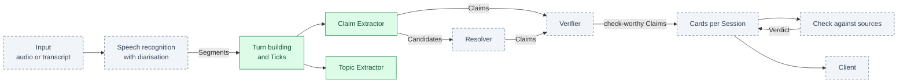
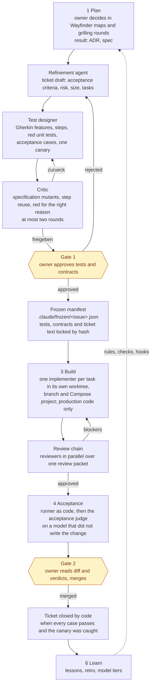
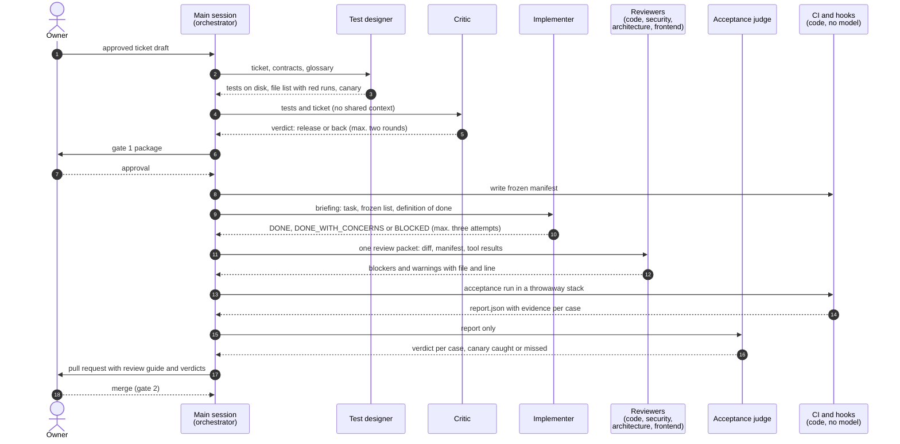
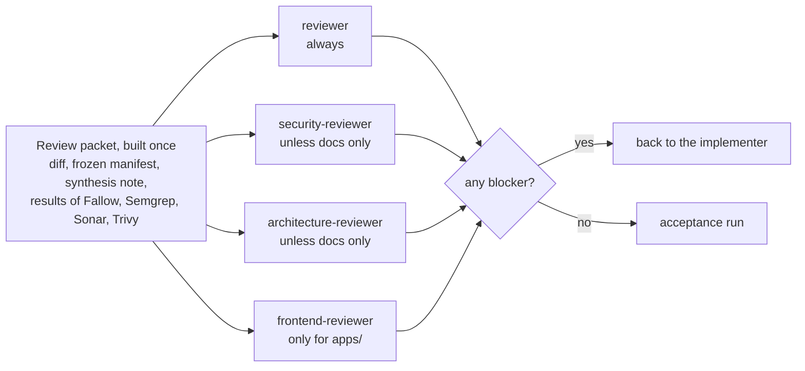
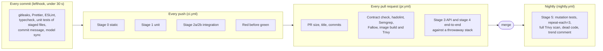
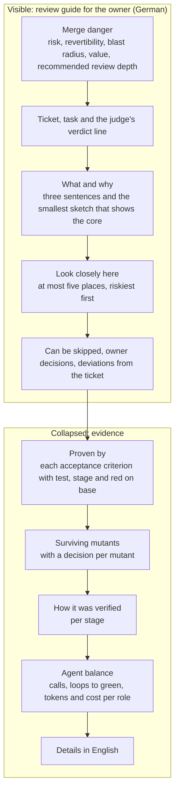
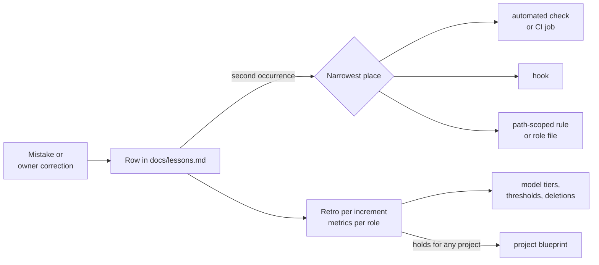

# live-factchecker-v2

**English** · [Deutsch](README.de.md)

> **Reference copy.** This repository is a cleaned copy of a private project (state 2026-11-20) with a fresh history. The private project tests and measures against a Golden Set of excerpts from broadcast recordings, which cannot be published. Here two synthetic excerpts stand in for it (`evals/golden/README.md`): same structure and times, generated pseudo-words instead of speech, generated names instead of real persons. With them the suite runs as in the private project; checked locally on 2026-11-20: 1,543 unit tests in six workspaces, 45 integration scenarios (stage 2a), 11 API scenarios against the built stack (stage 3), typecheck, lint and format check, 223 tests of the tool scripts. Not included: the measurement harness under `evals/`, the measurement reports, the research notes under `docs/research/` (links to them from ADRs lead nowhere), issues and the previous history. GitHub Actions are switched off in this repository.

A product that listens to a spoken exchange, pulls out the factual claims in it, checks each one against sources and
shows the result on a card while the exchange is still running. This repository holds the product **and** the agent
work system that builds it: eleven AI agent roles with fixed responsibilities, two owner gates, and quality checks that
run as code.

The owner (Marco) leads the architecture and decides at the gates; agents write tests, code and reviews in separate
roles. The rule the whole system rests on: **whoever writes the code never writes its tests, and nobody repairs a test
to get green.**

| | |
|---|---|
| Status | Increment 1 in progress: backend detection pipeline, no client yet |
| Stack | TypeScript (strict, ESM), pnpm workspaces, Node LTS, Redis, Caddy, Docker Compose, GitHub Actions |
| Tests | Vitest and fast-check (unit), Cucumber (integration, API, end-to-end), Playwright, StrykerJS (mutation) |
| Agents | Claude Code with 11 roles, 12 hooks, 12 skills and 3 deterministic workflows under `.claude/` |

## Contents

1. [What the product does](#1-what-the-product-does)
2. [How a ticket becomes merged code](#2-how-a-ticket-becomes-merged-code)
3. [How the agents work together](#3-how-the-agents-work-together)
4. [Quality gates and test stages](#4-quality-gates-and-test-stages)
5. [The pull request](#5-the-pull-request)
6. [Learning loop](#6-learning-loop)
7. [Repository map](#7-repository-map)
8. [Commands](#8-commands)

## 1. What the product does

Audio or a transcript enters through an Input. Speech recognition cuts it into Segments (one Speaker each). The
detection service builds Turns from the Segments and analyses them on a Tick every five seconds of speech. Model roles
then extract, resolve and verify Claims; each Claim becomes a Card that later receives its Verdict.

Green: built in increment 1 so far, running against a mock model adapter (`services/detection`, with
`packages/contracts`, `packages/inputs`, `packages/providers`, `packages/service-kit`). Dashed: decided in the ADRs,
not built yet. The full picture with every decision and its source is `docs/architecture.md`; the terms are defined in
`CONTEXT.md`.

## 2. How a ticket becomes merged code

Every change follows the same path. The owner decides twice: at **gate 1** on what "done" means (tests and contracts,
before any code exists) and at **gate 2** on the finished pull request.

What makes the path hold:

- **Tests first, then frozen.** After gate 1 a hook denies every edit to the frozen files for all roles except the
  test designer; a Stop hook compares each frozen file with its hash before an agent may finish.
- **Red before green.** CI checks out the PR base, applies only the frozen tests and expects them to fail for the
  right reason (missing behaviour, not a syntax error or a missing package). Green on the base blocks the PR.
- **One task per PR**, under about 400 production lines, opened as a draft, squash-merged.
- **Low risk merges without the owner.** A PR rated low risk (revertible and local) that passed review, acceptance
  and CI and touches no protected path is merged by the main session and listed for the owner afterwards
  (`docs/process/pr-format.md`, "Auto-merge at low risk").

Details: `docs/process/rollen.md` (roles and gates), `docs/process/tickets.md` (ticket levels and template),
`docs/process/wayfinder.md` (planning maps and the daily owner hour).

## 3. How the agents work together

The orchestrating main session starts every agent with a written briefing; no agent calls another agent in free
sequence. The three chains that repeat (test design, review, acceptance) are deterministic scripts under
`.claude/workflows/`.

### Roles and model tiers

Stronger models check weaker ones, and the judge never runs on the model that wrote the change. The tiers live in
`.claude/models.json`; `tools/sync_agent_models.py --check` fails the build when a floor is broken.

| Role | Does | Never does | Tier |
|---|---|---|---|
| refinement | drafts the ticket from ADR and spec | writes code or tests | stark |
| test-designer | writes features, steps, red unit tests, acceptance cases, canary | writes production code | stark |
| critic | attacks the tests with specification mutants; veto before gate 1 | edits tests | spitze |
| implementer | makes the frozen red tests green | touches frozen tests, pushes, opens PRs | stark, effort by ticket risk |
| reviewer | finds agent shortcuts: weakened types and tests, gold plating | edits code | stark |
| security-reviewer | secrets, input limits, privacy boundary, CI security; every finding blocks | edits code | stark |
| architecture-reviewer | module boundaries, duplicated state, missing ADRs | edits code | spitze |
| frontend-reviewer | components, accessibility, i18n; only for changes under `apps/` | edits code | stark |
| acceptance-judge | judges the written expectation against the evidence | reads code, runs tests | spitze |
| platform-engineer | Dockerfiles, Compose, CI, Make targets by the twelve factors | touches the owner's stack | stark |
| platform-coach | accompanies tasks the owner builds by hand | builds for the owner | stark |

Tiers today: spitze = Claude Fable 5.1, stark = Claude Opus 5.5, mittel = Claude Sonnet 5.5, guenstig = Claude Haiku 5.5.

### The review chain

All reviewers receive the identical packet as their prompt prefix and start in parallel. They report with file and
line and never edit.

### Isolation

Every agent stack runs as its own Compose project `lfc-<issue>-<task>` with its own ports and throwaway secrets;
implementers work in a separate git worktree. Hooks deny access to secrets, to the owner's stack and to frozen files.
The hooks are early warning only; the real guards are the pre-commit checks (lefthook) and CI.

## 4. Quality gates and test stages

Each behaviour is tested on the lowest stage that can show it; there are no duplicates across stages. The target
split per ticket is about 80 % stage 1, 15 % stages 2a to 3 and at most 5 % stage 4.

| Stage | Question | Tool |
|---|---|---|
| 0 static | does it build and obey the mechanical rules | tsc strict, ESLint, Prettier, dependency-cruiser, gitleaks |
| 1 unit | does the module compute correctly | Vitest next to the module, fast-check for pure logic |
| 2a backend integration | do a service's modules work together | Cucumber in-process, containers only for infrastructure |
| 2b frontend integration | does the client behave against a mocked backend | Cucumber and Playwright (from increment 2) |
| 3 API | does the path run through the real stack | Cucumber over HTTP and WebSocket against the Compose stack |
| 4 end-to-end | does the user see the right thing | Cucumber and Playwright through the edge (from increment 2) |
| 5 nightly | what costs minutes or money | StrykerJS, repeated runs as flake finder, full image scan |

Further rules: a test that fails and passes on its single retry is flaky and gets an issue automatically; skipping or
quarantining a test is the owner's decision only. The two required checks are `ci passed` and `pr passed`;
`make ci-local` runs the same checks before a push. Details: `docs/process/test-strategy.md`,
`docs/process/review-tools.md`.

### Acceptance from the owner's view

Acceptance cases are written before the code and frozen with the tests. One of them is a **canary**: a case that is
plausibly worded but clearly wrong against the ticket. A judge that passes the canary is discarded and the run is
repeated once; if it fails again, the owner reads the report without a verdict.

## 5. The pull request

A PR is written for a reader who has not seen the ticket. The German review guide comes first, the technical details
are collapsed below it (`.github/pull_request_template.md`, rules in `docs/process/pr-format.md`).

- **Risk is derived, not felt.** Not revertible means contracts or schema, data, secrets, CI or outward-visible
  behaviour. Low risk = revertible and local; high = not revertible or system-wide; otherwise medium.
- **References are quoted, never bare.** Next to every acceptance criterion, decision or ADR number stands the
  sentence it refers to, so the PR reads without opening the ticket.
- **The judge's verdicts are a PR comment** per acceptance run, with one quote and at most two images per case.
- **Commits are in review order**: contract, red tests, logic, wiring, docs.

## 6. Learning loop

No mistake should happen twice. The first occurrence of an agent mistake or owner correction becomes one row in
`docs/lessons.md`; on the second occurrence it becomes a rule, preferably as an automated check instead of prose.

The retro reads the numbers the PRs collect (loops to green, tokens per role, share of justified reviewer findings,
judge quota) and may change model tiers. What would hold for any project flows back into a separate blueprint
repository from which new projects start.

## 7. Repository map

| Path | Content |
|---|---|
| `services/detection/` | the detection service: Segments in, Turns, Ticks, Claim and Topic events out |
| `packages/contracts/` | Zod schemas of every seam with generated JSON Schema; read-only for agents |
| `packages/inputs/`, `packages/providers/`, `packages/service-kit/` | replay Inputs, model adapters, logging, config, health and lifecycle |
| `tests/api/`, `tests/acceptance/`, `tests/fixtures/` | stage 3, acceptance cases with their runner, shared fixtures |
| `evals/` | two synthetic excerpts (`golden/`), the two prompts the service loads, one small recording fixture; the measurement harness is not part of this copy |
| `.claude/agents/`, `skills/`, `rules/`, `hooks/`, `workflows/` | roles, procedures, path-scoped rules, hooks, deterministic chains |
| `.claude/frozen/` | one manifest per ticket: what is locked after gate 1 |
| `.github/workflows/` | `ci.yml`, `pr.yml`, `main.yml`, `nightly.yml`, `stack-tests.yml` |
| `tools/` | check scripts in Python (standard library only), each with tests |
| `docs/adr/`, `docs/spec/`, `docs/architecture.md` | decisions, specifications and the picture they add up to |
| `docs/process/` | short forms of the process decisions |
| `CLAUDE.md`, `CONTEXT.md` | rules for every agent session; glossary |

## 8. Commands

Everything runs through `make` (`make help` lists the targets); Node tooling runs in the toolbox container
(`scripts/tb <cmd>`), never on the host.

| Command | Does |
|---|---|
| `make up` / `make down` | start or remove the owner's stack |
| `make dev` | owner's stack with detection in watch mode |
| `make test-unit` | stage 1 for every workspace |
| `WS=@lfc/detection make test-integration` | stage 2a against a throwaway Redis |
| `make ci-secrets ci-stack-up test-api ci-stack-down` | stage 3 against a throwaway stack |
| `make acceptance ISSUE=<n>` | acceptance cases of one ticket |
| `make ci-local` | the required CI checks before a push |
