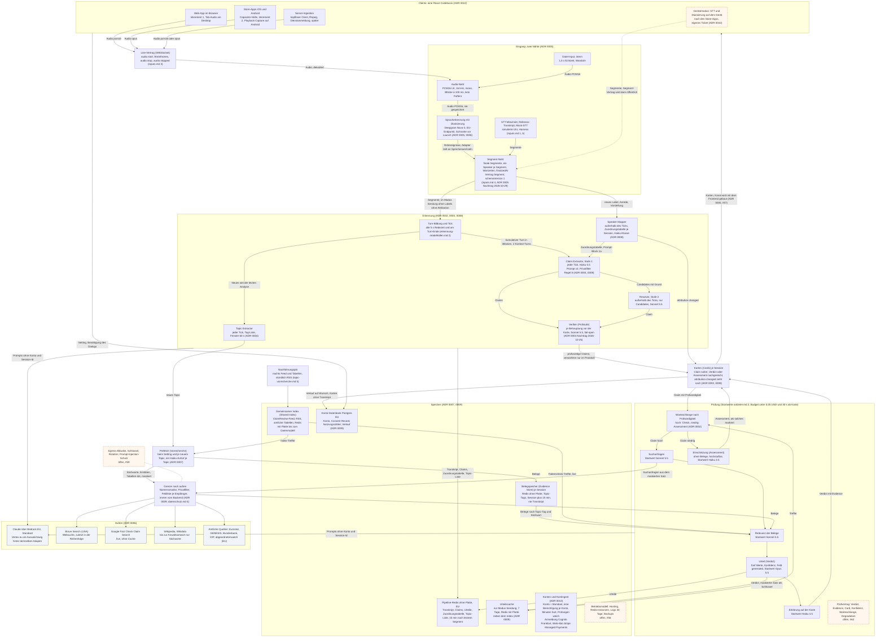
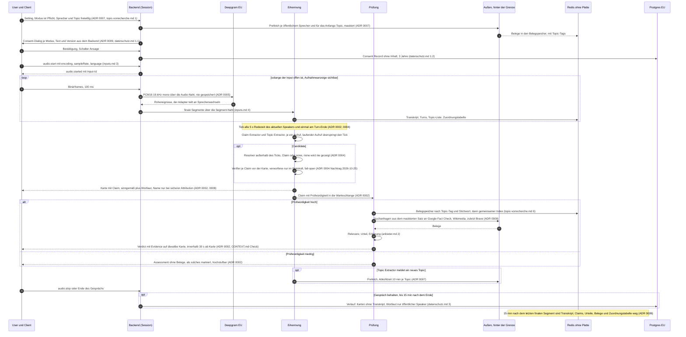

# Architekturbild

Zweck: das Bild, das die ADRs zusammen ergeben; kein neues Wort, nur Verweise. Jede Aussage trägt ihre Quelle in Klammern (ADR-Nummer oder Spezifikationsdatei mit Abschnitt). Begriffe nach `CONTEXT.md`; was dort nicht steht, ist hier auch kein Bauteil.

Stand: 2026-11-05, aus ADR 0002 bis 0010, 0012 und 0013 samt der Nachträge zu ADR 0003, 0004, 0005 und 0006, und den Spezifikationen `docs/spec/inputs.md`, `erkennung-modellrollen.md`, `topic-vorrecherche.md`, `sprecher.md`, `datenschutz.md`, `clients.md`, `anbieter.md`. ADR 0001 (Neubau) und ADR 0011 (Arbeitssystem) beschreiben kein Bauteil und kommen im Bild nicht vor.

Pflegeregel: Wer ein ADR schreibt oder einen Nachtrag macht, zieht dieses Bild im selben Commit nach (Knoten, Kanten, Tabellen, Stand). Wo die ADRs schweigen, steht "offen" mit Ticketnummer; gestrichelte Knoten sind offene Entscheidungen, durchgezogene sind entschieden.

## 1. Komponenten

Lesehilfe: Der Speaker Mapper, der Resolver und der Prefetch-Aufruf laufen außerhalb des Ticks; im Tick laufen nur Claim Extractor und Topic Extractor, je ein Aufruf, ohne Vortor (ADR 0004). Die Namensmaske sitzt an der Grenze nach außen, nicht im Prompt; die Prompts der Erkennung sehen die Namen aus dem Setting in beiden Modi (ADR 0002, erkennung-modellrollen.md 3). Richter und Zweitlabel des Messaufbaus (Gemini über Vertex Frankfurt, ADR 0003, 0006) sind Werkzeuge des Harness und kein Bauteil des Produkts. Die Verträge an den Nähten sind Zod-Schemas in `packages/contracts`; der Harness liest nur das daraus erzeugte JSON Schema (ADR 0012).

## 2. Datenfluss einer Conversation

Latenzbudget: p95 vom Ende des letzten Worts der Behauptung bis zur Karte ≤ 20 s (ADR 0003 Nachtrag 2026-10-23, vorher 15 s); Stufe 1 p95 ≤ 5 s je Aufruf (ADR 0004); die 30 s der Prüfung zählen ab Karte (ADR 0002).

## 3. Zustände einer Session

Kein ADR beschreibt die Session als Zustandsautomat; das Bild ist aus den Nachrichten des Live-Vertrags (inputs.md 3), den Regeln während des Gesprächs (datenschutz.md 1.3), der Unterbrechung (clients.md 4) und der Löschfrist (ADR 0009) abgeleitet. Die Session ist der technische Träger, die Conversation die Bedeutung (CONTEXT.md).

```mermaid
stateDiagram-v2
  angelegt : angelegt, Session-Id, Setting mit Modus
  consent : Consent, Dialog je Modus offen
  aktiv : aktiv, Input offen, Aufnahmeanzeige sichtbar
  unterbrochen : unterbrochen, Session lebt, kein Input offen
  beendet : beendet, Karten 15 min lesbar, Verlauf wählbar
  geloescht : gelöscht

  [*] --> angelegt : Client verbindet, Setting (ADR 0007)
  angelegt --> consent : Dialog angezeigt, ohne Bestätigung kein Input (datenschutz.md 1.1)
  consent --> beendet : Abbrechen
  consent --> aktiv : bestätigt, Consent Record geschrieben, audio.start (inputs.md 3)
  aktiv --> aktiv : Speaker ausnehmen, Umbenennen, Bestätigen (datenschutz.md 1.3, sprecher.md 3)
  aktiv --> unterbrochen : audio.stop durch Pause, Mikrofonverlust, Reconnect, Anruf (clients.md 4)
  aktiv --> unterbrochen : audio.stopped mit overloaded oder provider_error (inputs.md 2, 3)
  unterbrochen --> aktiv : Weiter, neuer Input in derselben Session (ADR 0010)
  aktiv --> beendet : audio.stopped mit quota_exceeded, Minuten des Kontos aufgebraucht, kein Weiter (ADR 0013)
  aktiv --> beendet : User beendet das Gespräch
  unterbrochen --> beendet : kein Weiter
  beendet --> geloescht : 15 min nach dem letzten finalen Segment, TTL je Schlüssel (ADR 0009)
  unterbrochen --> geloescht : dieselbe TTL läuft weiter, abgeleitet aus datenschutz.md 2
  geloescht --> [*]
```

Nach `quota_exceeded` gibt es kein "Weiter" bis zum nächsten Abrechnungszeitraum; ein `audio.start` mit Rest null bekommt dieselbe Antwort. Der Rand des Backends prüft bei jedem Verbindungsaufbau und bei jedem `audio.start`, also auch bei jedem "Weiter", das Token und die Konto-Zeile in Postgres (ADR 0013).

Was in keinem Dokument steht und deshalb offen ist: ob eine unterbrochene Session vor Ablauf der TTL ein eigenes Ende meldet, und wie eine Session ohne verbundenen Client für den Sender-Livestream läuft (inputs.md 8, Betriebsmodell #56).

## 4. Was lebt wo

| Komponente | Zustand | Aufbewahrung | Quelle |
|---|---|---|---|
| Audio | flüchtig, Durchlauf zur Audio-Naht und zu Deepgram EU | nie gespeichert, auch nicht im Zwischenspeicher | ADR 0005, ADR 0009, inputs.md 2 |
| Transkript, Claims, Urteile, Zuordnungstabelle, Topic-Liste einer Session | Redis ohne Platte (appendonly no, save '', tmpfs), EU | 15 min nach dem letzten finalen Segment | ADR 0009, datenschutz.md 2 |
| Belegspeicher (Evidence Store) | Redis ohne Platte, Schlüssel je Session | Session plus 15 min | ADR 0007, topic-vorrecherche.md 5 |
| Gemeinsamer Index (Shared Index) | Redis mit Platte, eigene Instanz, bis das Datenmodell entscheidet | dauerhaft, Einträge mit Abrufzeit und Quelle | ADR 0007, topic-vorrecherche.md 5 |
| Urteilscache | Redis mit Platte neben dem Index | 7 Tage je Eintrag, nur Modus Sendung, Löschpfad nach Behauptungstext | ADR 0009, datenschutz.md 6 |
| Consent Record | Postgres EU | 3 Jahre ab Bestätigung, überlebt die Kontolöschung | ADR 0009, datenschutz.md 1.2 |
| Nutzungszähler | Postgres EU | laufender Abrechnungszeitraum plus 1 Jahr | datenschutz.md 2 |
| Konto mit Berechtigung (Kennung `sub` von Cognito, Status, Zeitraum, Quelle, Kunden-Id bei Stripe) | Postgres EU | bis "Konto löschen" | ADR 0013 |
| Rechnungen, Zahlungsdaten | beim Verkäufer Stripe (Managed Payments), nicht in der Kontodatenbank | 10 Jahre | ADR 0009, ADR 0013, datenschutz.md 2 |
| Verlauf (History) | Postgres EU, je Konto | nur auf Wunsch je Gespräch, bis der User löscht | ADR 0009, datenschutz.md 3 |
| Anmeldung, Einstellungen, Setting-Vorlagen | Gerät, nur lokal | bis der User sie löscht, nie zum Konto | ADR 0010, clients.md 6 |
| Logs, Metriken und Traces | Betrieb, EU | 30 Tage, nie Transkripttext, Behauptungssatz, Namen | ADR 0009 (Nachtrag 2026-11-04 für Traces), datenschutz.md 2 |
| Backups | nur Kontodatenbank, verschlüsselt, EU | 30 Tage; Pipeline-Redis und Belegspeicher ohne Backup | ADR 0009 |

## 5. Offen

| Was | Ticket |
|---|---|
| Prüfvertrag: Verdict, Evidence, Card, Konfidenz, Warteschlange, Degradation; damit auch der Kartenkanal zum Client | #62 |
| Messaufbau der Prüfung: Modelle je Rolle, Abruf Stichwort gegen Embeddings, Prefetch-Trefferquote, Urteilscache bleibt oder fällt | #60 |
| Store-Abos: Abgleich mit der Berechtigung des Kontos, Eigenbau oder RevenueCat, doppeltes Abo in Web und Store | #176, Inkrement 2 (ADR 0013) |
| Tarifzahlen (Minuten, Prüfungen, Probezeit), Nachkauf, Schwelle der Warnung vor dem Stopp | #177, nach #60 (ADR 0013) |
| Dienstanmeldung und Kontingent je Dienst-Id der Ingestion: entschieden, nicht gebaut | mit dem ersten Partner (ADR 0013) |
| Haushalt und Team über Konten | Nebel, kein Ticket (ADR 0013) |
| Betriebsmodell: Hosting, die zwei Redis-Instanzen, Logs, Backups, Schlüsselablage, Session ohne verbundenen Client | #56 |
| Sicherheitsarchitektur: Egress-Allowlist, Schlüssel und Rotation, Prompt-Injection-Schutz, der mit dem stabilen Präfix verträglich ist | #59 |
| Live-Ansicht und Karte: Plakette, Umbenennen, Bestätigen, Teilen, Topic-Zeitleiste, Dialog, Pause, Speaker ausnehmen; Gäste lesen per Link mit (ADR 0013) | #57 |
| Nachmessung der Erkennung am Bedrock-EU-Endpunkt vor den ersten Gesprächsdaten; Modellwahl auf Golden Set Version 2 | Inkrement 2 (ADR 0006 Nachtrag 2026-10-25), #88 |
| Anwaltliche Prüfung und DSFA vor dem Launch, Deepgram-Schranke, Store-Ausnahmen; Erstattung beim Löschen mit laufendem Abo, Kündigungsbutton beim Verkäufermodell (ADR 0013) | #61 |
| Datenmodell: Ablage des gemeinsamen Index | Nebel, kein Ticket |
| Sender-Livestream, Programmdaten-Adapter, Setting aus Programmdaten | Nebel (inputs.md 8, sprecher.md 7) |
| Gerätemodus auf dem Smartphone, Desktop nativ mit Systemton, iOS-Tonabgriff | nach den Store-Apps, eigenes Ticket (ADR 0010, clients.md 13) |
| Session-Zustandsautomat, Live-Vertrag jenseits der Audio-Nachrichten, darin die erste Nachricht mit dem Access-Token, der Rest vor dem Start und die Warnung bei wenigen Restminuten (ADR 0013) | kein Ticket; der Live-Vertrag wird mit dem Frontend gebaut (ADR 0005) |
